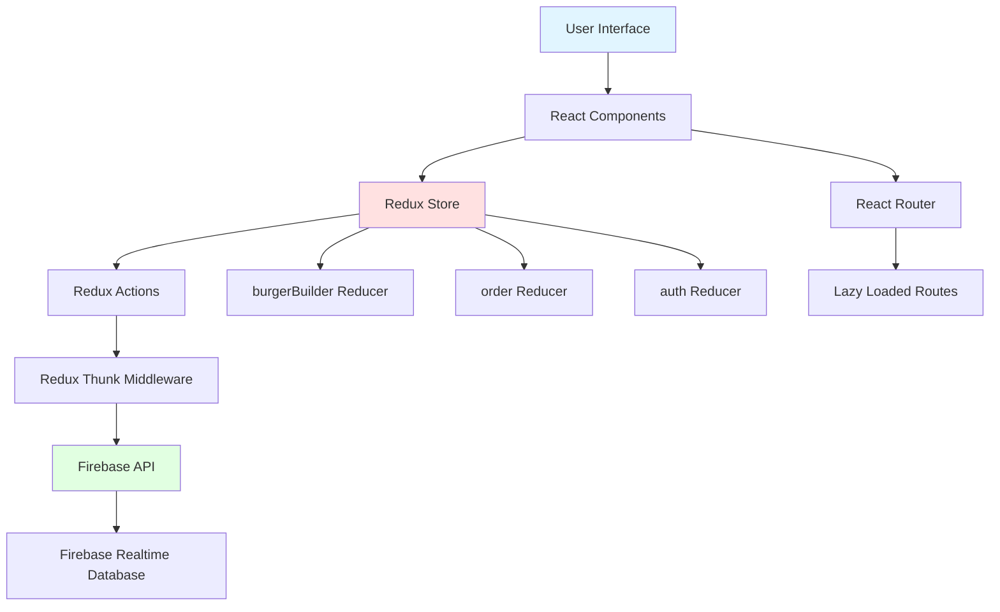
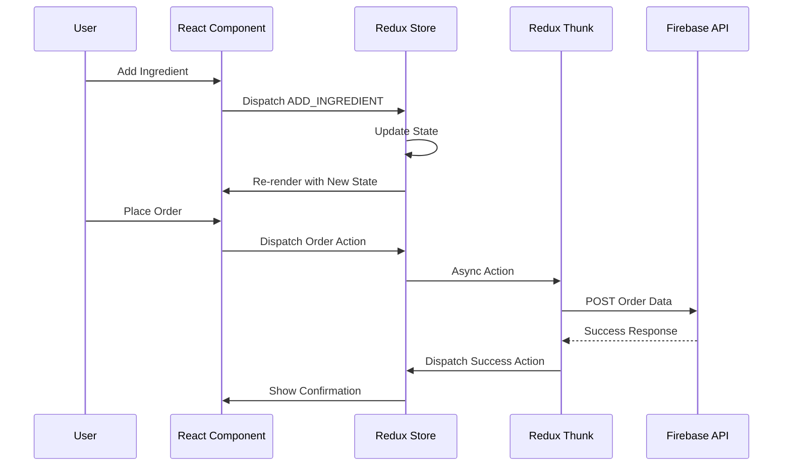
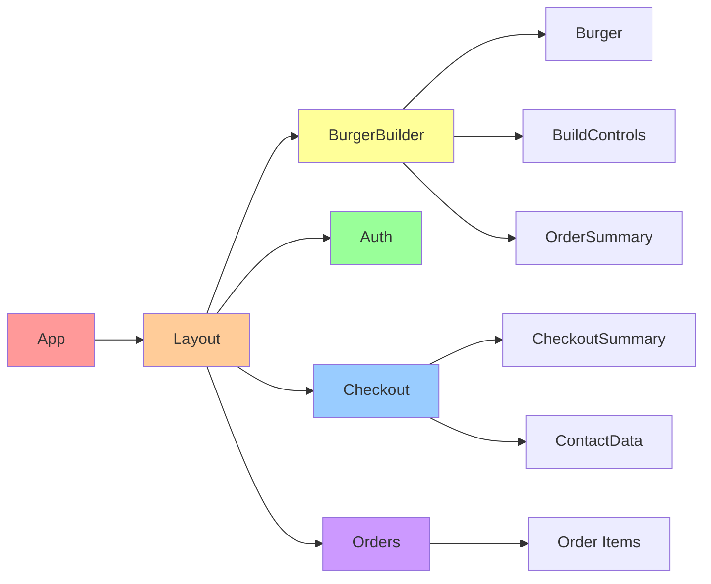

# Burger Builder

An interactive React application for building custom burgers with real-time pricing, user authentication, and order management. Built as part of the React Complete Guide course, showcasing modern React patterns, Redux state management, and Firebase integration.

Built in May 2018. This application demonstrates best practices in React development including Redux for state management, React Router for navigation, lazy loading, and authentication flows.

## Features

- 🍔 **Interactive Burger Builder**: Add and remove ingredients with real-time visual feedback
- 💰 **Dynamic Pricing**: See the total price update as you build your burger
- 🔐 **User Authentication**: Sign up and sign in with email/password
- 📦 **Order Management**: Place orders and view order history
- 🎨 **Responsive Design**: Works seamlessly on desktop and mobile devices
- ⚡ **Code Splitting**: Lazy loading for optimal performance
- 🔄 **Redux State Management**: Centralized state management with Redux and Redux Thunk
- 🌐 **Firebase Integration**: Backend powered by Firebase Realtime Database
- 🧪 **Tested Components**: Unit and integration tests using Jest and Enzyme

### Core Capabilities

- **Real-time Burger Customization**: Dynamic ingredient management with instant visual and price updates.
- **Secure Authentication Flow**: Full user lifecycle management including sign-up, sign-in, and persistent sessions.
- **Order Lifecycle Management**: End-to-end processing from building to checkout and historical tracking.
- **Responsive Interactive UI**: Adaptive layout ensuring a consistent experience across mobile and desktop devices.
- **Data Persistence**: Reliable storage of user orders and profiles using Firebase Realtime Database.

### Technical Excellence

- **State Management**: Robust centralized state handling using Redux with Thunk for asynchronous operations.
- **Component Architecture**: Clean separation of concerns through Container/Presentational pattern and HOCs.
- **Routing & Lazy Loading**: Optimized navigation with React Router and dynamic imports for performance.
- **Quality Assurance**: Comprehensive testing suite using Jest and Enzyme for components and logic.
- **Scalable Styling**: Scoped styles using CSS Modules to prevent global namespace pollution.

### Developer Experience

- **Hot Module Replacement**: Instant feedback during development with automatic browser refreshes.
- **Modular Design**: Highly organized codebase for easy navigation and feature extension.
- **Integrated Tooling**: Pre-configured build scripts and linting for consistent code quality.
- **Transparent State**: Easy debugging with Redux DevTools integration support.

## Architecture



## Data Flow



## Component Structure



## Getting Started

### Prerequisites

- Node.js (v12 or higher)
- npm or yarn
- Modern web browser

### Installation

1. Clone the repository:

```bash
git clone https://github.com/orassayag/burger-builder.git
cd burger-builder
```

2. Install dependencies:

```bash
npm install
```

3. Start the development server:

```bash
npm start
```

4. Open [http://localhost:3000](http://localhost:3000) in your browser

### Configuration

For Firebase integration, update `src/api/api.js` with your Firebase configuration:

```javascript
const instance = axios.create({
  baseURL: 'https://your-firebase-project.firebaseio.com',
});
```

## Available Scripts

### `npm start`

Runs the app in development mode with hot reloading.

### `npm test`

Launches the test runner in interactive watch mode.

### `npm run build`

Builds the app for production to the `build` folder.

### `npm run lint`

Checks code for linting errors.

## Usage

1. **Build Your Burger**: Use the control panel to add ingredients (Salad, Bacon, Cheese, Meat)
2. **View Price**: Watch the total price update in real-time
3. **Authenticate**: Sign up or sign in to enable ordering
4. **Place Order**: Click "ORDER NOW" to proceed to checkout
5. **Enter Details**: Fill in delivery information and select delivery method
6. **View Orders**: Check your order history in the Orders section

## Best Practices

- **Component Decomposition**: Breaking down the UI into small, reusable, and focused components.
- **Immutability**: Strict adherence to immutable state updates in Redux reducers.
- **HOC Pattern**: Utilizing Higher-Order Components for cross-cutting concerns like error handling and layout.
- **Lazy Loading**: Implementing route-based code splitting to minimize initial bundle size.
- **Validation**: Client-side form validation for a better user experience and data integrity.

## Development

### Workflow

1. **Feature Branching**: Create a new branch for every feature or bug fix.
2. **Local Development**: Use `npm start` for a local dev environment with hot reloading.
3. **Testing**: Run `npm test` to ensure no regressions are introduced.
4. **Building**: Use `npm run build` to generate production-ready assets.
5. **Linting**: Ensure code style consistency with `npm run lint`.

## Architecture Principles

- **Unidirectional Data Flow**: State updates follow a strict cycle (Action -> Reducer -> Store -> View).
- **Separation of Concerns**: Clear distinction between presentational (UI) and container (logic) components.
- **Stateless Components**: Maximizing the use of functional, stateless components for simplicity.
- **Centralized Logic**: Managing side effects and complex business logic within Redux Thunk actions.

## Directory Structure

```text
burger-builder/
├── config/                 # Build and environment configuration
├── public/                 # Static public assets (HTML, favicon)
├── scripts/               # Custom build, start, and test scripts
├── src/
│   ├── api/               # Axios instance and API configuration
│   ├── assets/            # Global assets like images and styles
│   ├── components/        # Presentational (stateless) components
│   ├── containers/        # Smart (stateful/Redux-connected) components
│   ├── hoc/              # Higher-Order Components (Layout, ErrorHandler)
│   ├── shared/           # Shared utility functions and validation
│   ├── store/            # Redux state management (actions, reducers)
│   ├── App.jsx           # Root application component
│   └── index.js          # Application entry point
└── package.json           # Project metadata and dependencies
```

## Design Patterns

- **Container/Presenter**: Decoupling logic from representation by separating smart and dumb components.
- **Higher-Order Components (HOC)**: Enhancing component functionality without code duplication (e.g., `withErrorHandler`).
- **Action Creators**: Standardizing action creation and handling asynchronous logic with Thunks.
- **CSS Modules**: Encapsulating styles to avoid naming collisions and promote modularity.

## Support

For support, please check the following resources:

- **Issues**: Report bugs or request features on the [GitHub Issues](https://github.com/orassayag/burger-builder/issues) page.
- **Documentation**: Refer to the existing codebase and comments for implementation details.
- **Contact**: Reach out to the author via email or LinkedIn (see [Author](#author) section).

## Technology Stack

- **React 16.4+**: UI library with component-based architecture
- **Redux 4.0**: State management with Redux Thunk for async actions
- **React Router 4.3**: Client-side routing with lazy loading
- **Axios 0.18**: HTTP client for API requests
- **Firebase**: Backend database and authentication
- **Enzyme & Jest**: Testing framework
- **CSS Modules**: Scoped component styling
- **Webpack 3**: Module bundler (via Create React App)

## Project Structure

```
burger-builder/
├── config/              # Build configuration
├── public/              # Static assets
├── scripts/             # Build scripts
├── src/
│   ├── api/            # API configuration
│   ├── components/     # Presentational components
│   ├── containers/     # Smart components (Redux-connected)
│   ├── hoc/            # Higher-order components
│   ├── store/          # Redux logic
│   │   ├── actions/   # Action creators
│   │   └── reducers/  # Reducers
│   ├── shared/        # Utility functions
│   ├── App.jsx        # Root component
│   └── index.js       # Entry point
└── package.json
```

## Redux Store Structure

```javascript
{
  burgerBuilder: {
    ingrediencies: {
      salad: number,
      bacon: number,
      cheese: number,
      meat: number
    },
    totalPrice: number,
    error: boolean
  },
  order: {
    orders: Array,
    loading: boolean,
    purchased: boolean
  },
  auth: {
    token: string | null,
    userId: string | null,
    error: object | null,
    loading: boolean,
    authRedirectPath: string
  }
}
```

## Testing

The project includes tests for critical components:

- `BurgerBuilder.test.jsx`: Main container tests
- `NavigationItems.test.jsx`: Navigation component tests
- `auth.test.js`: Authentication reducer tests

Run tests with:

```bash
npm test
```

## Deployment

### Firebase Hosting

```bash
npm run build
firebase deploy
```

### Other Platforms

Build and deploy to any static hosting:

- Netlify
- Vercel
- GitHub Pages
- AWS S3 + CloudFront

See [deployment documentation](https://facebook.github.io/create-react-app/docs/deployment) for details.

## Performance Optimizations

- **Code Splitting**: Routes are lazy-loaded using dynamic imports
- **Redux Optimization**: Selective re-renders with proper `mapStateToProps`
- **Memoization**: Component updates minimized with shouldComponentUpdate
- **Production Build**: Minified and optimized bundle

## Contributing

Contributions are welcome! Please read [CONTRIBUTING.md](CONTRIBUTING.md) for details on the code of conduct and the process for submitting pull requests.

## Author

- **Or Assayag** - _Initial work_ - [orassayag](https://github.com/orassayag)
- Or Assayag <orassayag@gmail.com>
- GitHub: https://github.com/orassayag
- StackOverflow: https://stackoverflow.com/users/4442606/or-assayag?tab=profile
- LinkedIn: https://linkedin.com/in/orassayag

## Acknowledgments

- Built for educational and research purposes
- Respects robots.txt and implements rate limiting
- Uses user-agent rotation to avoid detection
- Implements polite crawling practices

## License

This application has an MIT license - see the [LICENSE](LICENSE) file for details.
